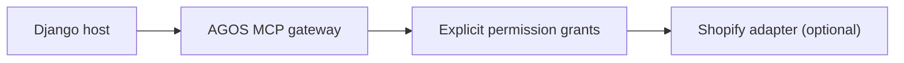

# django-agos-services

Install governed MCP tools and Shopify integrations inside an existing Django project.



The reusable Python package is `django-agos-services` (module `agos_services`). It provides per-client `ToolPermission` checks, an MCP SSE transport and an optional Shopify GraphQL integration. An existing Django project supplies the database, runtime configuration and deployment. Production security readiness is still under review.

## Get started

```bash
git clone https://github.com/AADigitalBusiness/agos-services.git
cd agos-services
python -m pip install -e ".[test]"
python manage.py migrate
python manage.py check
python -m pytest
```

To embed AGOS in another Django project, follow [Getting started](docs/02-getting-started.md). No PyPI release is confirmed.

## Documentation

| Task | Single source |
|---|---|
| Find documentation | [Documentation map](docs/00-map.md) |
| Review requirements of each planned Python module | [Module requirements](docs/requirements/00-scope.md) |
| Validate readiness and acceptance | [Validation matrix](docs/requirements/09-validation-matrix.md) |
| Install in Django | [Getting started](docs/02-getting-started.md) |
| Understand system boundaries | [Architecture](docs/03-architecture.md) |
| Operate and verify | [Operations](docs/08-operations.md) |
| Understand namespaced tool IDs | [MCP overview](agos_services/apps/mcp_server/docs/01-overview.md) |
| Review accepted design | [Service namespaces](agos_services/apps/mcp_server/docs/07-decisions/0001-service-namespaces.md) and [approved modular architecture](docs/07-decisions/0001-modular-python-boundaries.md) |

This repository follows the [AAD-docs documentation standard](https://github.com/AADigitalBusiness/AAD-docs/blob/main/docs/HOW-DOCS-WORK.md): cross-app information at `docs/`, app-owned documentation in `<app>/docs/`, Mermaid diagrams, and one owner per fact. The AAD-docs renderer itself is not installed here because this project currently pins Django below 5.2.

## License

See the repository's applicable license and distribution metadata before redistribution.
