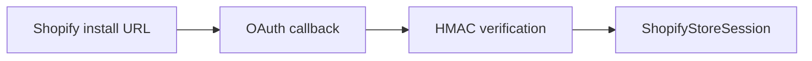

# Shopify authorization and sessions

Understand how Shopify installation and callback credentials are handled.

`ShopifyAuthService` verifies callback HMAC signatures and exchanges codes. `ShopifyStoreSession` persists store credentials. This Django app is a Shopify-specific integration, not the general AGOS client permission system.

The host must configure Shopify credentials and protect session-backed OAuth flows. Do not expose tokens in logs or documentation. Verify OAuth state handling and signature validation before a production deployment.

## Next

Read [operations](../../../../docs/08-operations.md) and [channels](../../channels/docs/01-overview.md).
