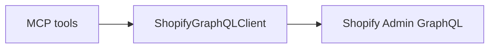

# Shopify GraphQL adapter

Understand the optional Shopify provider used by the MCP gateway.

The `ShopifyGraphQLClient` in `client.py` executes GraphQL operations, manages retries and obtains configured store access tokens. The MCP server registers Shopify tools only when `AGOS_ENABLE_SHOPIFY_TOOLS=True`.

The source code owns the exact query strings and arguments. For exposed tool names, use the [MCP overview](../../mcp_server/docs/01-overview.md) instead of maintaining a second list.

## Next

Review [architecture](../../../../docs/03-architecture.md) and [operations](../../../../docs/08-operations.md).
