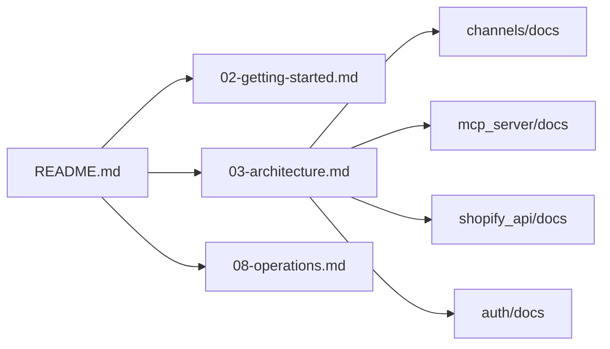

# Documentation map

Find the operational and application documentation for django-agos-services.

| Question | Source |
|---|---|
| How do I install AGOS into Django? | [Getting started](02-getting-started.md) |
| How does the MCP privilege boundary work? | [Architecture](03-architecture.md) |
| How do I run and verify the service? | [Operations](08-operations.md) |
| Which service names and permission rules are authoritative? | [MCP server documentation](../agos_services/apps/mcp_server/docs/01-overview.md) |
| How are client grants stored? | [Channels overview](../agos_services/apps/channels/docs/01-overview.md) |
| What Shopify operations exist? | [Shopify adapter overview](../agos_services/apps/shopify_api/docs/01-overview.md) |
| Where are Shopify OAuth sessions managed? | [Auth overview](../agos_services/apps/auth/docs/01-overview.md) |
| Why are canonical namespaces required? | [Accepted decision 0001](../agos_services/apps/mcp_server/docs/07-decisions/0001-service-namespaces.md) |
| What is proposed for app-local discovery? | [Proposed decision 0002](../agos_services/apps/mcp_server/docs/07-decisions/0002-explicit-app-service-discovery.md) |

## Next

Start with [Getting started](02-getting-started.md).
