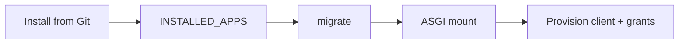

# Getting started

Install the reusable Django gateway and enable its governed MCP transport.



## Before you start

Use Python 3.11 or newer and a compatible Django 5.0–5.1 project. The runtime currently specifies `django>=5.0,<5.2`; **AAD-docs itself requires Django 5.2+**, so following its file layout does not mean installing `aad_docs` in this release.

## Steps

1. Install a reviewed commit (replace `<sha>` with a verified full commit SHA).

   ```bash
   python -m pip install "git+https://github.com/AADigitalBusiness/agos-services.git@<sha>"
   ```

2. Add the gateway components to the host `settings.py`.

   ```python
   INSTALLED_APPS += [
       "rest_framework",
       "oauth2_provider",
       "agos_services.apps.channels.apps.ChannelsConfig",
       "agos_services.apps.mcp_server.apps.McpServerConfig",
   ]
   MCP_AUTH_REQUIRED = True
   AGOS_ENABLE_SHOPIFY_TOOLS = False
   ```

   Enable Shopify only when required: add `agos_services.apps.shopify_api.apps.ShopifyApiConfig`, `agos_services.apps.auth.apps.AuthConfig` and set `AGOS_ENABLE_SHOPIFY_TOOLS = True`.

3. Apply models and existing grants.

   ```bash
   python manage.py migrate
   ```

4. Mount optional Django administrative and Shopify routes from your host's `urls.py`.

   ```python
   from django.urls import include, path
   urlpatterns += [path("agos/", include("agos_services.urls"))]
   ```

5. Mount the MCP SSE transport in the host's `asgi.py`.

   ```python
   import os
   os.environ.setdefault("DJANGO_SETTINGS_MODULE", "myproject.settings")
   from django.core.asgi import get_asgi_application
   from agos_services.asgi import mount_mcp
   application = mount_mcp(get_asgi_application())
   ```

6. Provision an active `MCPClient` with explicit `ToolPermission` grants in Django Admin. Grant names such as `shopify.products.list`, not legacy `get_products`.

## Result

Run `python manage.py check`; call `/mcp/sse` with a valid client token to test the transport. Missing grants must be denied. Run the complete suite before exposing endpoints on the network.

## Next

Read [Architecture](03-architecture.md), then [Operations](08-operations.md) for security and deployment caveats.
