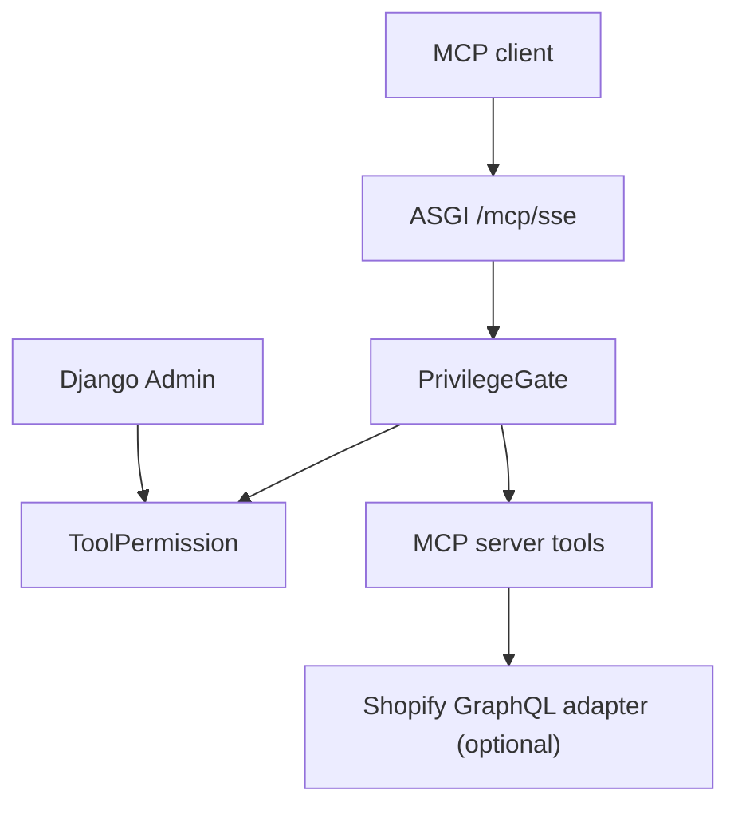

# Architecture

Understand where authentication, authorization, MCP transport and provider adapters meet.

## Boundaries

- `agos_services.asgi.mount_mcp` mounts SSE and JSON-RPC message routes ahead of Django.
- `agos_services.apps.channels` owns `MCPClient` and `ToolPermission` model records. Absent or denied grants fail closed.
- `agos_services.apps.mcp_server` registers tools and enforces permissions before invoking provider code.
- `agos_services.apps.shopify_api` owns Shopify GraphQL calls. `agos_services.apps.auth` owns Shopify OAuth and store sessions.
- `config/` is a standalone sample/host project, **not** the reusable library configuration.

## Naming contract

An exposed operation has one canonical key: `provider.resource.action`, for example `shopify.products.list`, `shopify.orders.get` or `github.issues.create` (the latter is only an example, not an implemented integration). Permission records use exactly the same key as the tool registered by MCP. A data migration moves existing Shopify grants to the new names.

The host can disable Shopify registration with `AGOS_ENABLE_SHOPIFY_TOOLS=False`. This does not install another provider automatically.

## Current limitations

The current SSE transport authenticates the connection and each tool receives a `client_token` parameter. Token ownership across SSE message/session boundaries needs a separate review before deploying it as a multi-tenant network service. The permission model stores UUID tokens directly, and the code does not demonstrate a complete rate-limit enforcement gate. Do not infer protections from old marketing documentation.

## Next

Read [MCP overview](../agos_services/apps/mcp_server/docs/01-overview.md) and [Operations](08-operations.md).
