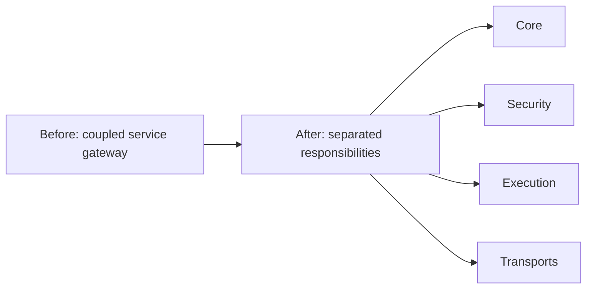

# 0001 · Separate modular Python boundaries

Record the approved product boundaries for AGOS Services without declaring the refactor complete.

**Status:** Accepted · 2026-11-22

## Context

AGOS must serve multiple independent Django applications and agents, while its present gateway combines service discovery, authorization and MCP-specific execution concerns. Those responsibilities must remain testable and change independently as additional providers are introduced.

## Decision

AGOS Services will have four distinct Python module boundaries: **core**, **security**, **execution** and **transports**.

- Core owns the service catalog, discovery, stable identifiers and service contracts.
- Security owns authenticated identity, permissions, credential lifecycle and access policy.
- Execution owns authorized invocations, result semantics and execution evidence.
- Transports expose supported client protocols without owning the business operations.

Existing Django applications and provider adapters remain separate integration concerns. Their current implementation is not replaced by acceptance of this decision.

## Alternatives considered

Retain the current combined gateway structure. This would minimize immediate migration work but sustain coupling between service capabilities and the MCP transport.

## Consequences

The modularization is an architectural target requiring incremental compatibility checks. Current application identities, migrations and existing service identifiers must be preserved or have explicit migration outcomes. Documenting the boundaries does **not** authorize refactoring or imply that the new packages already exist.

## Validation expectations

The boundaries will be accepted as delivered only when separate providers can register and execute through the shared contract, security decisions remain independent of transport, and existing clients retain their supported behavior. Applicable outcomes are defined in [Core](../requirements/01-core.md), [Security](../requirements/02-security.md), [Execution](../requirements/03-execution.md) and [Transports](../requirements/04-transports.md).

## Next

Read [decision 0002 on the execution engine](0002-transport-independent-execution.md) and the [functional acceptance matrix](../requirements/09-validation-matrix.md).
