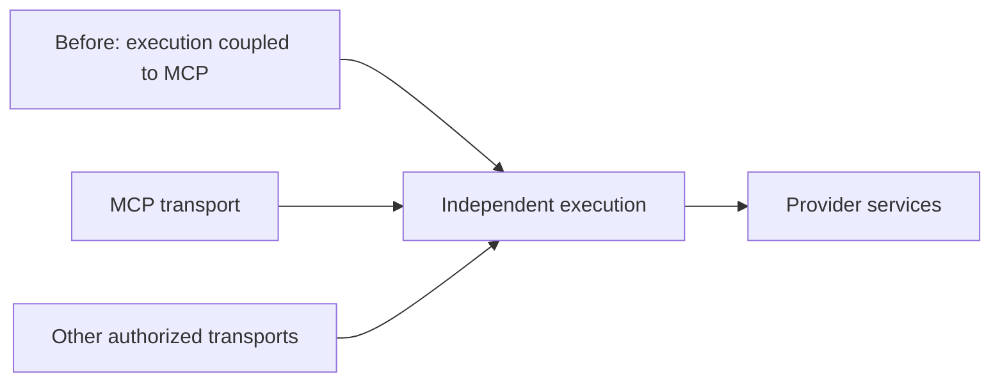

# 0002 · Independent service execution engine

Record the decision that execution is a platform capability rather than an MCP-specific feature.

**Status:** Accepted · 2026-11-22

## Context

AGOS is expected to serve agents and Django applications through more than one possible client interface. Service permissions and outcomes must remain consistent regardless of the communication protocol. An execution path that exists only inside MCP would unnecessarily restrict future consumers.

## Decision

The service execution engine will be **independent of MCP**. MCP will remain a supported transport, not the owner of provider execution or authorization rules. Every supported client path must preserve the verified identity, applicable permissions, requested operation and attributable outcome.

This decision does not approve additional transports for the first release.

## Alternatives considered

Keep execution directly inside the MCP server. This is simpler for a single protocol but duplicates or couples business behavior when additional transports are introduced.

## Consequences

Existing MCP tool behavior must remain testable during separation. No transport may bypass authorization, fabricate a principal or execute a service outside the common execution boundary. The engine is a future implementation target; this ADR alone does not change runtime behavior.

## Validation expectations

An allowed service invocation and a denied service invocation must have equivalent authorization outcomes when exercised through any two supported transports. The execution outcome must be attributable without leaking credentials. See [Execution requirements](../requirements/03-execution.md) and [Transport requirements](../requirements/04-transports.md).

## Next

Read [decision 0001 on module boundaries](0001-modular-python-boundaries.md) and [decision 0003 on initial deployment](0003-single-process-sse-deployment.md).
