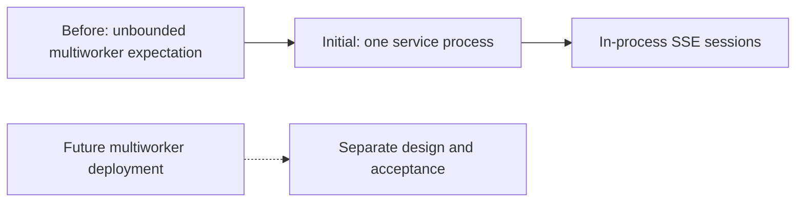

# 0003 · Single-process initial SSE deployment

Record the approved initial hosting constraint for MCP SSE sessions.

**Status:** Accepted · 2026-11-22

## Context

The current MCP SSE transport maintains session ownership and message routing state in process. Deploying multiple independent processes without a coordinated session strategy could break message delivery or create inconsistent session behavior.

## Decision

The initial supported deployment topology will use **a single service process with local SSE sessions**. Multiworker and multi-replica operation are not part of the initial supported topology. This decision does not prohibit revisiting distributed sessions later, but such support requires a separate architecture decision and validation.

A single process does not relax authentication, authorization, session ownership or resource-limit requirements.

## Alternatives considered

- Deploy with multiple processes and session affinity. Additional routing and operational constraints would require end-to-end validation.
- Introduce shared session coordination from the first release. This increases the initial implementation and reliability scope beyond the approved deployment target.

## Consequences

Deployment guidance must explicitly describe the one-process constraint and the effect of process restarts on active sessions. Initial capacity and availability are limited by that topology. Operators must not claim multiworker support or silent session survival on restart.

## Validation expectations

Concurrent clients in the supported single-process deployment must remain isolated; cross-client messages must be refused; restart or session loss must yield a predictable client-visible result. See [Transport requirements](../requirements/04-transports.md) and [Operations requirements](../requirements/07-operations.md).

## Next

Read [decision 0004 on Django compatibility](0004-django-52-compatibility.md) and the [operational requirements](../requirements/07-operations.md).
