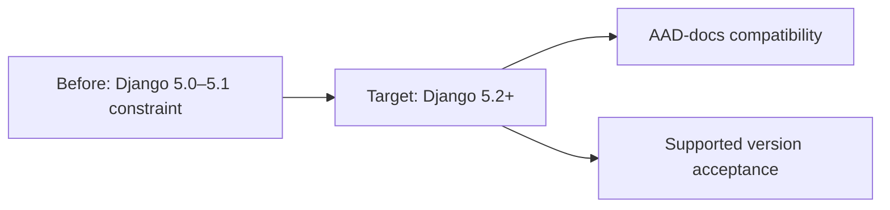

# 0004 · Adopt Django 5.2 or newer

Record the approved Django compatibility direction for the AGOS Services package and AAD-docs integration.

**Status:** Accepted · 2026-11-22

## Context

AGOS currently declares a Django dependency below version 5.2, whereas integration with the AAD-docs documentation application requires a compatible Django baseline. Maintaining the older constraint would prevent adopting the shared documentation viewer in an AGOS host.

## Decision

Adopt **Django 5.2 or newer as the compatibility direction**, with the exact upper bound and additional supported versions determined by tested compatibility. Django 5.0 and 5.1 will not be part of the future supported baseline after the compatibility transition. AAD-docs support is an intended outcome.

This decision approves the target, **not an immediate dependency change or an untested claim that all future Django versions are supported**.

## Alternatives considered

Preserve support for Django 5.0–5.1 while postponing AAD-docs integration. This avoids an immediate compatibility transition but sustains divergent documentation requirements.

## Consequences

The eventual release must communicate that older hosts may require an upgrade. Dependency declarations, independent-host validation and the documentation experience must be aligned before announcing the new support matrix. Current installations remain unchanged by this ADR.

## Validation expectations

A clean host running an explicitly supported Django version must install AGOS, complete its database migration and exercise permitted service behavior. A compatible host must also be able to navigate AGOS documentation through AAD-docs. See [Django integration requirements](../requirements/05-django-integration.md) and [Release gates](../requirements/09-validation-matrix.md).

## Next

Read [decision 0001 on modular boundaries](0001-modular-python-boundaries.md) and [Django integration requirements](../requirements/05-django-integration.md).
