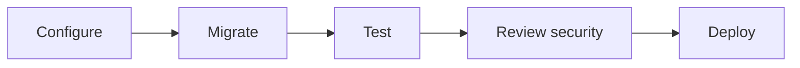

# Operations

Run, test and review the AGOS gateway safely.



## Before you start

Use a local clone, a Python 3.11/3.12 environment and the host project's configured database. Never commit production secrets.

## Steps

1. Install dependencies and tests.

   ```bash
   python -m pip install -e ".[test]"
   ```

2. Verify Django, database migrations and packaging.

   ```bash
   python manage.py check
   python manage.py migrate
   python -m pytest
   python -m pip install build
   python -m build
   ```

3. Review environment and access policy before deployment: non-default `SECRET_KEY`, restrictive `ALLOWED_HOSTS`, HTTPS, secure Shopify secrets and no public admin provisioning endpoint. Keep `MCP_AUTH_REQUIRED=True`.

4. After changing tool identifiers, run `migrate` before serving new tool names. Verify old grants map correctly and deny-by-default still applies.

5. Review CI on both supported Python versions and the independent-host wheel installation check; do not merge while package tests or security review are failing.

## MCP transport security status

Both `GET /mcp/sse` and `POST /mcp/messages/` now require an authenticated client token. This is **request authentication only**, not proof that a POST belongs to the client which created the SSE session. The current SSE SDK transport retains shared message routing state, so the host must not expose a multi-tenant shared MCP endpoint as production-ready until session-to-client binding and cross-client message isolation have been implemented and tested. Restrict deployments to trusted environments in the meantime. A token passed as a tool argument does not establish channel identity.

CI creates an isolated virtualenv, installs the *built wheel* into a separate Django host, applies migrations and verifies the ASGI mount and permission records; this test does not certify remote session isolation.

## Documentation workflow

Use the [AAD-docs authoring standard](https://github.com/AADigitalBusiness/AAD-docs/blob/main/docs/HOW-DOCS-WORK.md): root docs only for cross-app information, application-specific pages in each app's `docs/`, one owner for each fact, English defaults and Mermaid diagrams. Because this gateway currently pins Django below 5.2, do not install the `aad_docs` renderer until dependency compatibility is resolved. The Markdown structure remains portable to it.

## Next

Use [Documentation map](00-map.md) to locate an application's guide.
