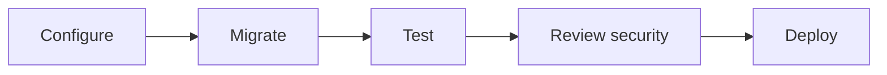

# Operations

Run, test and review the AGOS gateway safely.



## Before you start

Use a local clone, a Python 3.11/3.12 environment and the host project's configured database. Never commit production secrets.

## Steps

1. Install dependencies and tests.

   ```bash
   python -m pip install -e ".[test]"
   ```

2. Verify Django, database migrations and packaging.

   ```bash
   python manage.py check
   python manage.py migrate
   python -m pytest
   python -m pip install build
   python -m build
   ```

3. Review environment and access policy before deployment: non-default `SECRET_KEY`, restrictive `ALLOWED_HOSTS`, HTTPS, secure Shopify secrets and no public admin provisioning endpoint. Keep `MCP_AUTH_REQUIRED=True`.

4. After changing tool identifiers, run `migrate` before serving new tool names. Verify old grants map correctly and deny-by-default still applies.

5. Review CI on both supported Python versions and the independent-host wheel installation check; do not merge while package tests or security review are failing.

## MCP transport security status

Both `GET /mcp/sse` and `POST /mcp/messages/` require an authenticated client token. AGOS assigns the verified `MCPClient.pk` to the MCP SDK's `AuthenticatedUser` in the ASGI scope for **both** requests. On SSE creation, the SDK records the principal as the session owner; on POST, its session guard compares the principal before delivering a message. Requests from another authenticated client receive the same 404 as an unknown session.

The SDK maintains an in-memory session map. Sessions therefore require sticky routing to the same process in a multi-worker deployment; cross-replica session sharing is not supported. Tool calls now use an SDK-injected `Context` to resolve the authenticated ASGI principal and reload the active `MCPClient`; they no longer expose `client_token` as a tool argument. This is a breaking tool signature change. Requests without a verified HTTP principal fail closed, including direct/stdin tool invocation without an explicit supported identity bridge. Do not deploy an unreviewed multi-tenant MCP gateway publicly.

CI checks session ownership against the installed MCP SDK and installs a built wheel into an independent Django host. Passing automated checks does not substitute for penetration testing or production security review.

## Documentation workflow

Use the [AAD-docs authoring standard](https://github.com/AADigitalBusiness/AAD-docs/blob/main/docs/HOW-DOCS-WORK.md): root docs only for cross-app information, application-specific pages in each app's `docs/`, one owner for each fact, English defaults and Mermaid diagrams. Because this gateway currently pins Django below 5.2, do not install the `aad_docs` renderer until dependency compatibility is resolved. The Markdown structure remains portable to it.

## Next

Use [Documentation map](00-map.md) to locate an application's guide.
