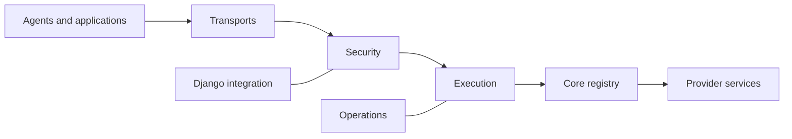

# Module requirements

Define the functional outcomes and acceptance evidence for the planned modular AGOS Services architecture.

## Scope and status

This collection defines **target requirements**, not an assertion that the planned Python packages exist today. The present package includes Django applications under `agos_services/apps/`, a service registry and an MCP gateway. Requirements are separated from implementation status. Changes to this documentation alone do not implement a feature or certify production readiness.

Modules have distinct ownership: core describes **what services exist**; security decides **who is permitted**; execution handles **what happens on invocation**; transports expose **how clients communicate**; Django integration provides **application lifecycle and persistence**; provider services supply business capabilities; operations governs **readiness and observability**.

## Acceptance policy

- Every requirement has an identifier and an observable pass/fail outcome.
- A module is accepted only after its functional criteria have supporting test or operational evidence.
- No requirement is satisfied merely by successful import, a passing build, or a written design.
- Negative cases, tenant boundaries and denied access must be validated wherever applicable.
- No acceptance claim should be made for undocumented providers or multi-process behavior.
- The [validation matrix](09-validation-matrix.md) is the single owner of cross-module release gates.

## Module specifications

| Module | Primary responsibility | Specification |
|---|---|---|
| Core | Service catalog and discovery | [Core](01-core.md) |
| Security | Identity, grants, credential lifecycle and limits | [Security](02-security.md) |
| Execution | Authorized invocation and auditable outcomes | [Execution](03-execution.md) |
| Transports | MCP sessions and communication boundaries | [Transports](04-transports.md) |
| Django integration | Host and application integration | [Django integration](05-django-integration.md) |
| Provider services | Shopify and independent provider capabilities | [Provider services](06-provider-services.md) |
| Operations | Diagnostics, compatibility and release | [Operations](07-operations.md) |
| Governance | External policy and approval boundary | [Governance](08-governance.md) |

## Next

Use [Core requirements](01-core.md) or inspect the [validation matrix](09-validation-matrix.md).
