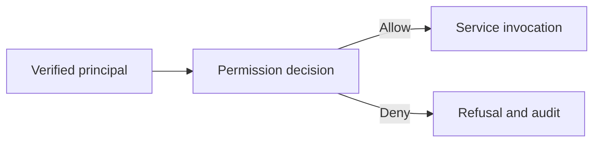

# Security module requirements

Define trusted identities, authorization, credential lifecycle and abuse controls for all service execution.

## Functional requirements

| ID | Requirement |
|---|---|
| SEC-01 | Each request shall be associated with an authenticated and active principal established through a trusted channel. User-supplied service arguments shall not select or replace that principal. |
| SEC-02 | Every invocation shall require an explicit grant for the exact service identifier. Missing, revoked or denied grants shall result in refusal. |
| SEC-03 | Clients and organizations shall have isolated identities and permission scopes. One principal shall not inherit another principal's permissions, even with knowledge of a session identifier. |
| SEC-04 | Credentials shall support secure issuance, revocation, expiry and rotation without exposing reusable secrets in routine audit output. |
| SEC-05 | Revocation and deactivation shall take effect on subsequent requests, including requests made through an existing session. |
| SEC-06 | Effective limits shall restrict abusive request volume and shall generate an observable refusal when exceeded. |
| SEC-07 | Security-sensitive operations shall produce an attributable record of the principal, target service, outcome and reason for denial without recording secrets. |
| SEC-08 | A failure in identity or policy resolution shall deny execution rather than allow it. |
| SEC-09 | Permission decisions shall be made for the authenticated organization and resource scope, not just for a matching service name. |

## Validation and acceptance

| Requirement | Observable acceptance criterion |
|---|---|
| SEC-01, SEC-08 | Missing or invalid identity and attempted identity override in an operation payload are rejected before business execution. |
| SEC-02 | A granted principal succeeds and an ungranted, explicitly denied or revoked principal fails against the same service. |
| SEC-03, SEC-09 | Client B cannot use client A's session or permissions; access to resources belonging to another organization is rejected. |
| SEC-04, SEC-05 | A rotated or revoked credential stops authenticating; a replacement credential works only with its own authorization. |
| SEC-06 | Requests beyond the configured threshold are refused and can be distinguished from a provider failure. |
| SEC-07 | Evidence of allow/deny is attributable and contains no reusable secret. |

## Acceptance boundary

Passing authentication tests does not establish production readiness. Credential lifecycle, authorization scope, throttling and negative multiuser tests must all be evidenced.

## Next

Read [Execution requirements](03-execution.md) and the [release gates](09-validation-matrix.md).
