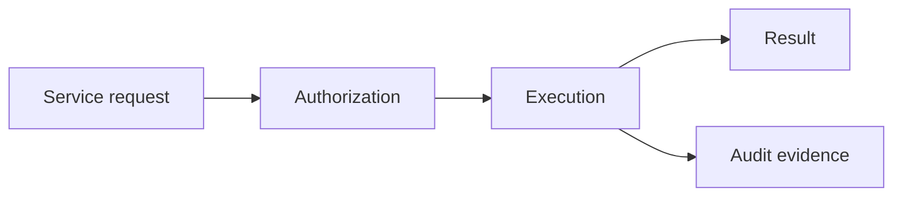

# Execution module requirements

Define the observable behavior of a governed service invocation from acceptance through final outcome.

## Functional requirements

| ID | Requirement |
|---|---|
| EXE-01 | Only a discoverable, enabled and authorized service may start execution. |
| EXE-02 | Every invocation shall have a traceable identity, originating client, service identifier and terminal outcome. |
| EXE-03 | A successful invocation shall provide an understandable result and a failed invocation a consistent error category. |
| EXE-04 | Invalid inputs shall be rejected before any business-side effect. |
| EXE-05 | Failures, timeouts and interrupted operations shall have distinguishable outcomes; the platform shall not report success without supporting evidence. |
| EXE-06 | An operation with external side effects shall make duplicate-submission behavior explicit to consumers and operators. |
| EXE-07 | Execution records shall not leak credentials or unrelated client data. |
| EXE-08 | Provider failures shall not authorize fallback execution against a different provider or tenant. |

## Validation and acceptance

| Requirement | Observable acceptance criterion |
|---|---|
| EXE-01 | Unknown, disabled and ungranted operations produce denial without invoking the provider. |
| EXE-02, EXE-07 | Every attempted invocation can be correlated to a principal and result; an audit inspection exposes no credentials. |
| EXE-03 | Success, invalid request, denied permission and provider failure produce distinct outcomes. |
| EXE-04 | Invalid parameters cause no observable provider-side mutation. |
| EXE-05 | An interrupted or timed-out invocation is not falsely recorded as successful. |
| EXE-06 | A repeated write request follows a documented, testable duplicate-handling rule. |
| EXE-08 | Failure of one provider cannot trigger a call to a different provider or organization. |

## Exclusions

Execution does not own the policy defining who may run a service, nor the provider's underlying business rules.

## Python module responsibilities

| Planned module | Functional obligation | Verification |
|---|---|---|
| `execution/executor.py` | Execute only validated and permitted services (EXE-01, EXE-04). | Refused and invalid invocations produce no provider-side effect. |
| `execution/context.py` | Preserve the trusted caller and request identity throughout invocation (EXE-02, EXE-08). | Outcomes remain attributable and cannot switch organizations. |
| `execution/results.py` | Distinguish success, validation errors, denial, timeout and provider failure (EXE-03, EXE-05). | Every category has an unambiguous observable outcome. |
| `execution/audit.py` | Retain safe execution evidence (EXE-02, EXE-07). | An operator can trace an invocation without seeing credentials. |

## Next

Read [Transport requirements](04-transports.md) and [Security requirements](02-security.md).
