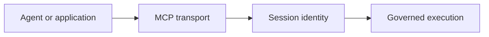

# Transport module requirements

Specify how clients access services while preserving verified identity, session ownership and response integrity.

## Functional requirements

| ID | Requirement |
|---|---|
| TRN-01 | A supported client shall discover and invoke permitted services using the advertised transport contract. |
| TRN-02 | Session creation and each subsequent message shall be authenticated against a valid principal. |
| TRN-03 | A session shall belong to one authenticated principal; another client shall not be able to submit messages to it. |
| TRN-04 | Session closure, expiration and loss shall result in predictable client-visible behavior, not cross-client reuse. |
| TRN-05 | Concurrent clients shall remain isolated in messages, responses and errors. |
| TRN-06 | Any supported multi-process or multi-instance deployment shall preserve session correctness, or explicitly constrain deployment to a topology that does. |
| TRN-07 | Invalid, oversized or unauthenticated messages shall be refused before business execution. |
| TRN-08 | Unsupported transports or tool calls without a verified identity shall fail closed rather than bypass authentication. |

## Validation and acceptance

| Requirement | Observable acceptance criterion |
|---|---|
| TRN-01 | A compatible MCP client can list and invoke an allowed operation end to end. |
| TRN-02, TRN-03 | The owner can use its session; missing credentials and a different valid client's credentials cannot. |
| TRN-04 | After closure or expiration, the session identifier cannot be reused to dispatch work. |
| TRN-05 | Two simultaneous clients cannot receive or affect each other's traffic. |
| TRN-06 | The documented deployment topology passes session continuity tests; unsupported topologies are clearly reported as unsupported. |
| TRN-07, TRN-08 | Malformed, unauthorized and unsupported requests are denied with no service-side effect. |

## Current boundary

The existing SSE implementation keeps session state in process. Cross-process continuity must not be claimed without evidence. See [Operations](../08-operations.md) for current deployment constraints.

## Next

Read [Django integration requirements](05-django-integration.md) and [Security requirements](02-security.md).
