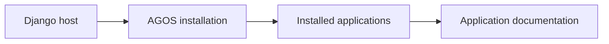

# Django integration module requirements

Define how AGOS operates as a reusable, independently installable component inside Django projects.

## Functional requirements

| ID | Requirement |
|---|---|
| DJG-01 | AGOS shall install into an independent Django host without requiring the standalone development project. |
| DJG-02 | Existing client identity and permission data shall remain valid through supported upgrades or have an explicit migration outcome. |
| DJG-03 | The host shall control enabled providers, allowed access and deployment configuration. Installing AGOS shall not expose a provider by default without required authorization. |
| DJG-04 | Applications shall expose their available services through the shared discovery contract without replacing the host's application lifecycle. |
| DJG-05 | Administrative views shall make grant state and client activation understandable while protecting sensitive credential material. |
| DJG-06 | The supported Django and Python versions shall be declared and verified, including documentation compatibility. |
| DJG-07 | Application documentation shall be discoverable under the AAD-docs conventions without duplicating generated model or route metadata. |

## Validation and acceptance

| Requirement | Observable acceptance criterion |
|---|---|
| DJG-01 | A clean Django host installs the distributed package, applies migrations and exposes an available permitted service. |
| DJG-02 | Upgrade fixtures preserve expected grant outcomes; denied grants do not become allowed. |
| DJG-03, DJG-04 | A disabled provider remains unavailable, and an enabled but ungranted provider remains nonexecutable. |
| DJG-05 | An operator can inspect status and grants without obtaining reusable stored credentials. |
| DJG-06 | Supported combinations pass the declared compatibility checks; unsupported combinations are stated. |
| DJG-07 | AAD-docs can navigate the package documentation in a compatible host, with no duplicate authoritative descriptions of models. |

## Existing applications

The current `channels`, `mcp_server`, `shopify_api` and `auth` Django apps remain existing product boundaries. This specification covers the **shared integration requirement**; individual current behavior remains documented in their respective app overviews.

## Next

Read [Provider service requirements](06-provider-services.md) and [Validation matrix](09-validation-matrix.md).
