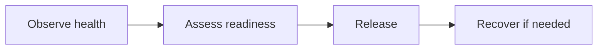

# Operations module requirements

Define operational visibility, release readiness and recoverability for AGOS installations.

## Approved initial operating constraints

[Decision 0003](../07-decisions/0003-single-process-sse-deployment.md) defines one process with local SSE sessions for the initial deployment. [Decision 0004](../07-decisions/0004-django-52-compatibility.md) defines the future Django compatibility baseline. These are release acceptance conditions, not currently completed deployments or dependency changes.

## Functional requirements

| ID | Requirement |
|---|---|
| OPS-01 | Operators shall be able to distinguish healthy operation, degraded provider functionality, authentication failures and unavailable transport. |
| OPS-02 | A release shall have reproducible build and compatibility evidence for the versions it declares as supported. |
| OPS-03 | Package upgrades shall have documented compatibility impact, including service names, client permissions and any migrations. |
| OPS-04 | Operational records shall allow authorized investigation of denied actions, provider failures and interrupted execution without revealing secrets. |
| OPS-05 | Operators shall be able to detect sustained errors, unusual request volume and exhausted capacity. |
| OPS-06 | Service recovery and rollback expectations shall be explicit; recovery shall not silently restore revoked permissions. |
| OPS-07 | A deployed topology shall state whether transport sessions are supported with one process, many workers or multiple replicas. |
| OPS-08 | Release readiness shall distinguish CI success from demonstrated security and operational acceptance. |
| OPS-09 | The initial deployment shall explicitly declare one SSE process, in-memory session lifetime, interruption behavior and capacity limitations. |

## Validation and acceptance

| Requirement | Observable acceptance criterion |
|---|---|
| OPS-01, OPS-05 | Controlled incidents yield distinct operator-visible states and alerts/records. |
| OPS-02 | The published distribution installs and passes smoke checks in an independent compatible Django host. |
| OPS-03 | A release review identifies compatibility changes before promotion. |
| OPS-04 | A denied call or provider failure can be traced to an outcome without exposing secrets. |
| OPS-06 | A recovery rehearsal preserves intended authorization and documents the outcome. |
| OPS-07 | A session survives the advertised deployment topology or that topology is expressly unsupported. |
| OPS-08 | Release approval is withheld when a required security or recovery gate lacks evidence, even if CI passes. |
| OPS-09 | A deployment review verifies one SSE process and that a restart invalidates old sessions without changing their ownership. |

## Current scope

The actual commands and day-to-day operational procedure have one authoritative home in [Operations](../08-operations.md). This page owns only **required outcomes and their acceptance criteria**.

## Python module responsibilities

| Planned module | Functional obligation | Verification |
|---|---|---|
| `management/commands/` | Provide operator-visible inventory and diagnostics (OPS-01, OPS-04). | An authorized operator can identify service and access status. |
| `checks.py` | Identify unsafe, unsupported or incomplete configuration (OPS-02, OPS-07). | Known invalid configurations do not appear healthy. |
| Release and distribution boundary | Communicate compatibility and readiness evidence (OPS-02, OPS-03, OPS-08). | Release reviewers can distinguish completed acceptance from untested features. |

## Next

Read [Governance requirements](08-governance.md) and [Validation matrix](09-validation-matrix.md).
