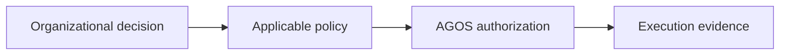

# Governance boundary requirements

Define AGOS's relationship with external organizational approval and decision systems.

## Functional requirements

| ID | Requirement |
|---|---|
| GOV-01 | AGOS shall distinguish service permission from broader organizational approval. A technical grant shall not imply a required human approval was received. |
| GOV-02 | When an operation requires an external approval, absent, expired or rejected approval shall prevent that operation. |
| GOV-03 | Authorization decisions shall identify the relevant organization, client, service and resource scope. |
| GOV-04 | Failure to obtain required governance information shall produce a refusal rather than an implicit approval. |
| GOV-05 | Execution outcomes shall be available as attributable evidence to authorized organizational systems without exposing secrets. |
| GOV-06 | AGOS shall remain usable without a particular governance product where no external approval policy has been configured. |
| GOV-07 | Agents-OS and AAD-nodes shall be integrations with defined responsibilities, not hidden prerequisites for every host. |

## Validation and acceptance

| Requirement | Observable acceptance criterion |
|---|---|
| GOV-01, GOV-02 | A technically permitted operation requiring human approval is blocked until a valid approval is present. |
| GOV-03 | An approval for one organization, resource or service is rejected for another. |
| GOV-04 | A missing or unavailable mandatory approval source cannot be bypassed. |
| GOV-05 | An authorized reviewer can match an execution outcome with its approved decision and client. |
| GOV-06, GOV-07 | A standalone host can run a service with ordinary policy, and enabling an external governance integration does not bypass local grants. |

## Scope boundary

Agents-OS owns business process governance and human decisions. AAD-nodes owns workspaces and agent runtime. AGOS owns technical service availability, the local access boundary and attributable execution. This specification does not assert that those integrations are already implemented.

## Next

Read [Validation matrix](09-validation-matrix.md) and [Module scope](00-scope.md).
