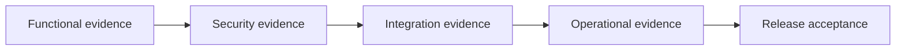

# Module validation and release gates

Provide one authoritative cross-module acceptance matrix for the modular AGOS Services target.

## Evidence standards

An acceptance result must identify the requirement, execution context, expected outcome, observed outcome and evidence location. Use **Pass**, **Fail**, **Blocked** or **Not tested**; do not equate a source file, a passing build or an unreviewed PR with functional acceptance.

## Cross-module gates

| Gate | Required evidence | Pass criterion |
|---|---|---|
| GATE-01 · Catalog | CORE-01 through CORE-07 | Only explicitly published, uniquely named and enabled services appear; unpublished services cannot run. |
| GATE-02 · Identity and access | SEC-01 through SEC-09 | Unauthorized, inactive, revoked and cross-organization requests fail closed; grants are exact and attributable. |
| GATE-03 · Invocation | EXE-01 through EXE-08 | Authorized outcomes, invalid requests, failures and duplicate writes behave as declared with traceable evidence. |
| GATE-04 · Protocol | TRN-01 through TRN-08 | Sessions are isolated; unsupported topologies and unauthenticated requests cannot dispatch work. |
| GATE-05 · Django host | DJG-01 through DJG-07 | A clean supported host installs the distribution, preserves grants and exposes navigable documentation. |
| GATE-06 · Provider | PRV-01 through PRV-08 | A live permitted provider works in its own scope, while unrelated/disabled providers remain unaffected. |
| GATE-07 · Operations | OPS-01 through OPS-08 | Diagnoses, release controls, monitoring and recovery have observable evidence. |
| GATE-08 · Governance | GOV-01 through GOV-07, when governance integration is enabled | External approvals cannot be bypassed and do not replace local tool grants. |

## Release decision

| Condition | Release disposition |
|---|---|
| Every applicable gate passes with evidence | Eligible for release review |
| Any applicable gate fails | Not accepted |
| A required gate is blocked or untested | Not accepted |
| A feature or integration is explicitly out of scope | Exclude from release claims and assess only the advertised capability set |

A passing CI run is necessary evidence for supported test coverage, **not** a complete security certification or automatic release approval.

## Next

Read the [module scope](00-scope.md) or the existing [operations guide](../08-operations.md).
